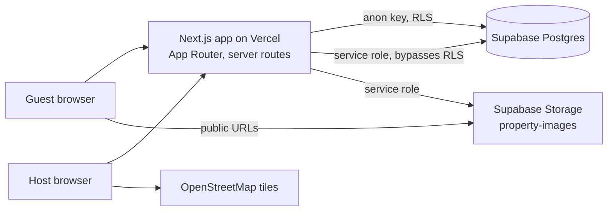
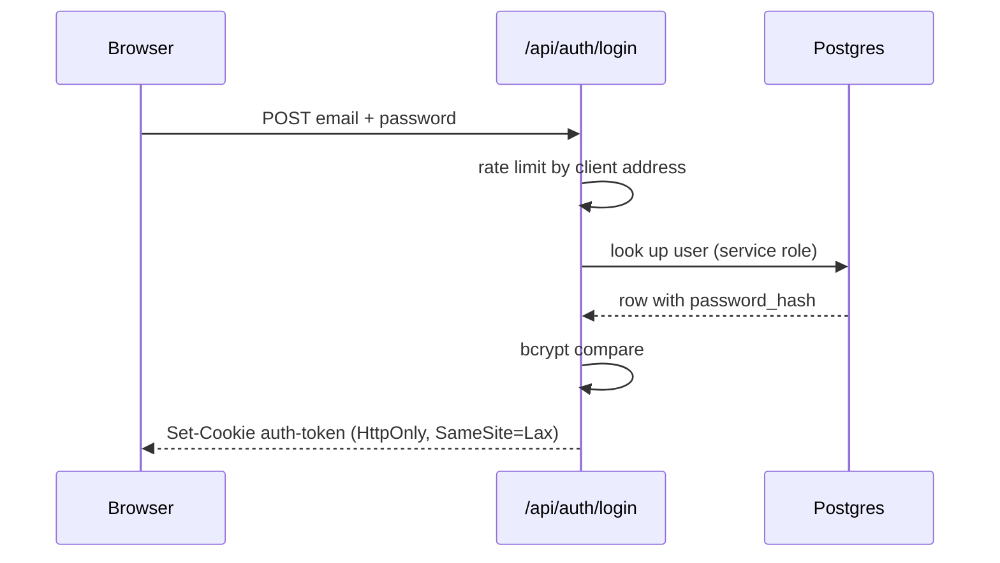
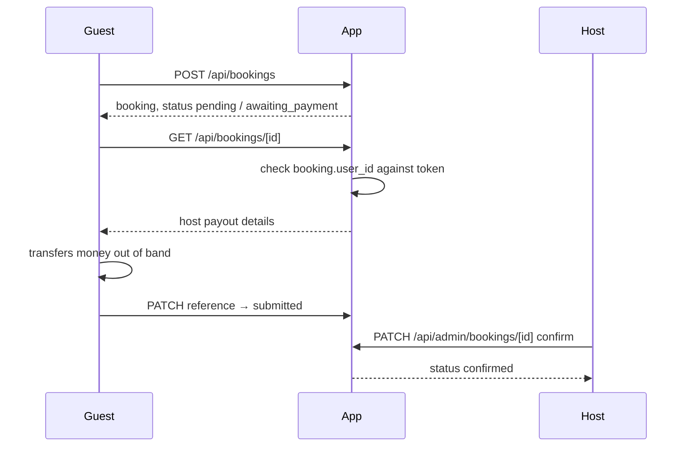

# Architecture

InCA Homes is a vacation-rental listing and booking site for properties in the
Philippines. Guests browse listings, book a stay and settle by bank transfer,
GCash or PayMaya. Hosts list properties through a guided flow and confirm
payments by hand.

## Containers

## Modules

| Path | Owns |
|---|---|
| `src/app/api/**` | HTTP entry points. Authenticate, authorise, validate, delegate. |
| `src/lib/auth.ts` | Password hashing, JWT issue/verify, user lookups. |
| `src/lib/supabase/server.ts` | Anon client for public reads. Bound by RLS. |
| `src/lib/supabase/admin.ts` | Service-role client. Server-only. Bypasses RLS. |
| `src/lib/storage.ts` | Listing photo uploads to Supabase Storage. |
| `src/lib/payments.ts` | Payment method specs, host payout details, night counting. |
| `src/lib/listing-wizard.ts` | Listing wizard shape, steps and validation. |
| `src/lib/rate-limit.ts` | Postgres-backed shared rate limiting. |
| `src/components/host/**` | Listing wizard UI primitives. |

## Data model

- **users** — `id`, `email` (unique, stored lowercase), `password_hash`,
  `name`, `role` (`guest` | `admin`), `last_login`.
- **properties** — listing fields plus `images` and `amenities` as JSONB, and
  `listing_details` JSONB for wizard fields without their own column
  (property type, privacy type, beds, bathroom breakdown, occupancy,
  highlights, instant-book, weekend pricing, coordinates, host payout details).
- **bookings** — `property_id`, `user_id`, dates, `guests`, `nights`,
  `total_price`, `status`, and `payment_method` / `payment_reference` /
  `payment_status`.
- **analytics**, **rate_limits**.

Money is stored as `DECIMAL(10,2)` in pesos.

## Trust boundaries

Everything crossing these is untrusted and validated server-side:

1. **Browser → API routes.** Request bodies, query strings, cookies, uploaded
   files. Bodies are parsed into allowlisted shapes; unknown keys never reach
   an insert.
2. **Browser → Supabase (anon key).** The key is public. RLS is the only thing
   restricting it, and it permits exactly one thing: reading active listings.
3. **Supabase Storage → browser.** Uploaded photos are public URLs. The bucket
   restricts type and size; uploads go through the service role.
4. **OpenStreetMap tiles.** Third-party images in the host wizard.

## Authorisation

| Caller | Can |
|---|---|
| Anonymous | Read active listings. Sign up, log in. |
| `guest` | The above, plus their own account, their own bookings, and submitting a payment reference against a booking they own. |
| `admin` | Everything: create and edit properties, read analytics, confirm or reject payments. |

Enforced in each route handler, not in middleware. A valid token with an
insufficient role gets **403**; a missing or invalid token gets **401**.

### Login

### Booking and payment

The money never moves through the app. `payment_status` records what the two
parties claim and what the host confirmed.

## Known limitations and accepted risks

- **Host == admin.** There is no separate host role, and property routes are
  not scoped by owner, so any admin can edit any listing. Acceptable while one
  operator runs the site; needs an ownership model before third-party hosts.
- **Manual settlement.** No gateway, so no automatic reconciliation, refunds
  or chargeback handling.
- **CSP is Report-Only.**
- **Dark mode is half-declared.** `globals.css` darkens `body` under
  `prefers-color-scheme: dark` while the UI uses fixed light classes, so any
  page without its own background renders unreadable.
- **Free-tier Supabase pauses** after inactivity, taking the site down with it.
